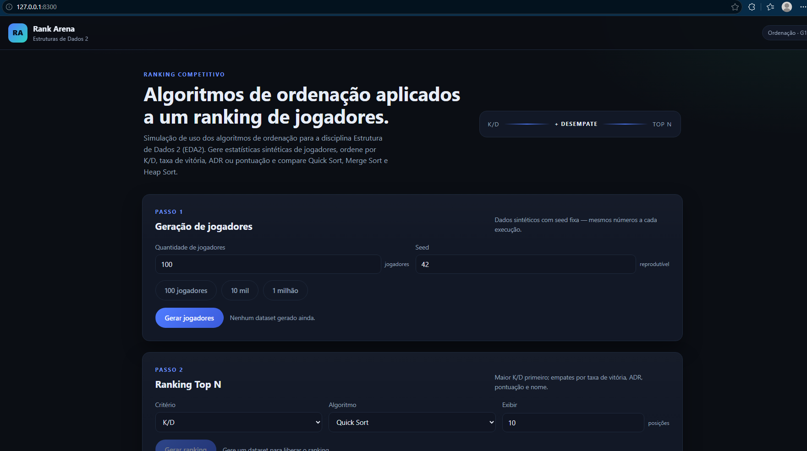

# G11_Ordenacao_EDA2-2026.2

**Conteúdo da disciplina:** Algoritmos de Ordenação

**Tecnologias:** JavaScript (ES modules), HTML e CSS, sem frameworks ou dependências externas.

## Sobre o projeto

O projeto é uma aplicação web interativa que demonstra e compara algoritmos de ordenação usando um ranking de jogadores como cenário. Os dados são sintéticos e podem ser gerados de forma reproduzível usando uma seed.

O usuário escolhe um critério para ordenar o ranking — K/D, taxa de vitória, ADR ou pontuação — e pode visualizar o Top N. Os empates são resolvidos por critérios secundários, garantindo uma ordem consistente.

## Funcionalidades

- Gerar de 1 até 2 milhões de jogadores sintéticos com seed configurável.
- Ordenar e exibir um ranking por critério selecionado.
- Comparar Quick Sort, Merge Sort e Heap Sort usando os mesmos dados.
- Exibir tempo de execução, comparações, movimentações e trocas; comparar também a estabilidade dos algoritmos.
- Executar benchmarks com 100, 10.000 e 1.000.000 de jogadores, incluindo comparação com `Array.sort`.
- Exportar os resultados do benchmark em CSV pela interface.

## Algoritmos

- **Quick Sort:** particiona os dados em torno de um pivô; em média, executa em $O(n \log n)$, mas pode chegar a $O(n^2)$ no pior caso. Não é estável.
- **Merge Sort:** divide os dados e intercala as partes ordenadas; executa em $O(n \log n)$ e é estável, usando memória auxiliar.
- **Heap Sort:** ordena usando uma estrutura de heap; executa em $O(n \log n)$ no pior caso e não é estável.

## Captura de tela



## Site
Acesse ele [aqui](https://eda2-2026.github.io/G11_Ordenacao_EDA2-2026.2/).

## Vídeo
Assista o vídeo de apresentação [aqui](https://youtu.be/oLmctz4HfGI).

## Como executar

É necessário um navegador moderno. Para servir a aplicação localmente, execute na raiz do repositório:

```bash
python3 -m http.server 8000
```

Abra [http://localhost:8000](http://localhost:8000) no navegador. Servir a página por HTTP permite que os módulos JavaScript sejam carregados corretamente.

## Testes e benchmark

É necessário ter Node.js instalado. Os comandos definidos no `package.json` são:

```bash
npm test
npm run benchmark
```

O primeiro executa a suíte de testes automatizados. O segundo roda o benchmark padrão e exibe os resultados no terminal. Os tempos podem variar conforme o computador e o ambiente de execução.

## Estrutura do projeto

```text
.
├── index.html
├── package.json
├── assets/
│   └── print.png
├── css/
│   └── style.css
├── js/
│   ├── algoritmos/
│   │   ├── comum.js
│   │   ├── heap-sort.js
│   │   ├── merge-sort.js
│   │   └── quick-sort.js
│   ├── app.js
│   ├── benchmark.js
│   ├── criterios.js
│   ├── estabilidade.js
│   ├── formato.js
│   ├── gerador.js
│   ├── jogador.js
│   ├── modo-geracao.js
│   ├── ordenacao.js
│   └── rng.js
├── scripts/
│   └── benchmark.js
└── tests/
   ├── helpers/
   │   └── fake-dom.js
   ├── benchmark.test.js
   ├── criterios.test.js
   ├── estabilidade.test.js
   ├── gerador.test.js
   ├── heap-sort.test.js
   ├── interface.test.js
   ├── merge-sort.test.js
   ├── modo-geracao.test.js
   └── quick-sort.test.js
```
